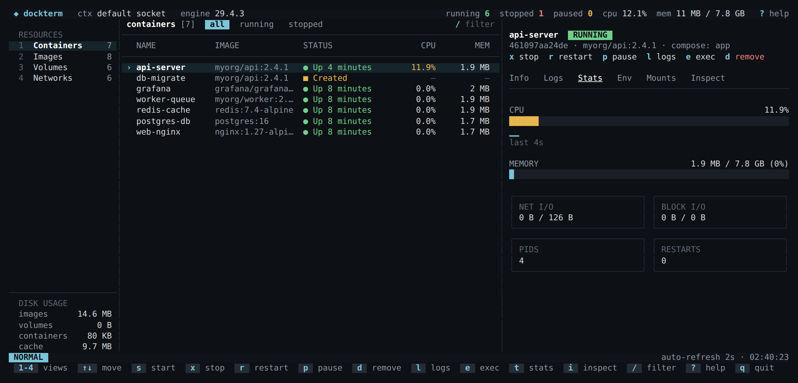

# dockerterm

A terminal UI for Docker: browse containers, images, volumes and networks, watch live CPU and memory, read logs, open a shell and start/stop/remove things without leaving the terminal.



## Install

Requires Go 1.25 or newer.

```sh
go install github.com/kushbhardwaj28/dockerterm@latest
```

Or build from a clone:

```sh
make build   # produces ./dockerterm
```

## Usage

```sh
dockerterm                     # uses DOCKER_HOST, else your current docker context
dockerterm -host unix:///var/run/docker.sock
dockerterm -interval 5s        # refresh less often
dockerterm -debug              # writes a debug log to $TMPDIR/dockerterm-debug.log
```

| Key | Action |
| --- | --- |
| `1` `2` `3` `4` | containers / images / volumes / networks |
| `↑` `↓` / `j` `k`, `g` / `G` | move, first / last |
| `/`, `Esc`, `f` | filter by text, clear, cycle all / running / stopped |
| `Tab`, `J` / `K` | next detail tab (Info, Logs, Stats, Env, Mounts, Inspect), scroll it |
| `s` `x` `r` `p` | start, stop, restart, pause / unpause |
| `d` | remove (asks first); also removes images, volumes and networks |
| `l` `t` `i` | jump to logs, stats, inspect |
| `e` | open a shell in the container (uses the `docker` CLI) |
| `Enter` | toggle the details pane |
| `ctrl+r`, `?`, `q` | refresh now, help, quit |

Environment variables whose names look secret (`*PASSWORD*`, `*TOKEN*`, `*KEY*`…) are masked in the Env tab.

### Which daemon it connects to

The same order the docker CLI uses: `-host`, then `DOCKER_HOST`, then `DOCKER_CONTEXT` or the current context in `~/.docker/config.json` (so Docker Desktop, Colima and OrbStack contexts work), then the platform default socket. `DOCKER_TLS_VERIFY`, `DOCKER_CERT_PATH` and `DOCKER_API_VERSION` are honoured. `ssh://` hosts are not supported yet.

## Development

```sh
make test    # go test -race ./...
make lint    # golangci-lint run
make run     # go run . -debug
```

Layout:

```
main.go             flags, debug log, wiring
internal/docker     Docker Engine API client (github.com/moby/moby/client) and UI-friendly types
internal/ui         Bubble Tea model, layout, table and key bindings
```

The UI depends on a small `ui.Backend` interface rather than the Docker client, so the model is tested with a fake backend and the Docker package is tested against a fake Engine API server.
